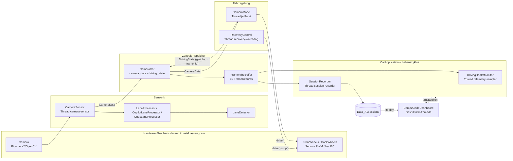

# Camp2Code Team Polo – Architektur (Version 6.0)

Dieses Dokument beschreibt den **tatsächlichen** Stand nach der Konsolidierung.
Grundlage ist der Quellcode (`camp2code-complete.txt`, Stand 27.10.2026), nicht das Zielbild.
Abweichungen zum Referenzdiagramm v5.1 stehen in Abschnitt 9.

## 1. Überblick



## 2. Module und Verantwortungen

| Schicht | Modul | Verantwortung |
|---|---|---|
| Hardware (Vorgabe, unverändert) | `basisklassen.py`, `basisklassen_cam.py` | Servo, Motoren, IR, Ultraschall, Kamera |
| Fahrzeug | `BaseCar` → `SonicCar` → `SensorCar` → `CameraCar` | Stellwerte (Lenkung, Speed-Steuerwert), Sensorwerte, thread-sicherer Datenspeicher |
| Sensorik | `CameraSensor` | Aufnahme, **eine** Bildverarbeitung je Frame, Veröffentlichung als `CameraData` |
| | `InfraredSensor`, `UltrasonicSensor` | IR/US-Messung (im Dashboard-Betrieb nicht gestartet) |
| Bildverarbeitung | `pipeline_processors.py`, `lane_detector.py`, `LenkwinkelKalkulator.py` | ROI → HSV → Maske → Blur → Morphologie → Canny → Linien |
| Fahrregelung | `driving/` (ein Modul je Fahrmodus), `Driving.py` (Kompatibilitäts-Router) | Entscheidungen, Fahrbefehle, Stoppursachen |
| Datenmodelle | `models/` | `CameraData`, `DrivingState`, `SensorSnapshot` (keine Hardwarelogik) |
| Telemetrie | `telemetry/` | `FrameRingBuffer`, `FrameRecord`, `FrequencyCounter`, `DurationStats` |
| Ereignisse | `driving_health.py` | Zustandsübergänge, Stoppursachen, Recorder-/Bergungsereignisse |
| Aufzeichnung | `session_recorder.py` | Session-Format v2, Laden mit Cache, Export |
| Replay | `replay_hud.py`, `replay_selection.py` | HUD auf Bildkopie, Frame-ID-Bereiche |
| Darstellung | `dashboard_overlay.py`, `dashboard_steering.py` | gemeinsame Zeichenfunktionen (Live + Replay) |
| Anwendung | `car_application.py` | erzeugt und beendet alles genau einmal |
| Dashboard | `Camp2CodeDashboard.py` (Start), `dashboard/` (Shell + Tab-Klassen), `assets/` | sechs Ansichten als Plug-ins, ausschließlich über `CarApplication` |

## 3. Vererbung

```
Loggable (CarLogger)
└── BaseCar ── SonicCar ── SensorCar ── CameraCar
                                    └── MockSensorCar
Camera (basisklassen_cam) ── CameraSensor
Infrared ── InfraredSensor          Ultrasonic ── UltrasonicSensor
LaneProcessor ── CopilotLaneProcessor
             └── OpusLaneProcessor (dunkle Linien: Blackhat + Otsu)
DashboardTab (abc) ── DrivingTab · PipelineTab · TelemetryTab · RecordingTab · ReplayTab · SettingsTab
DrivingMode (abc)
├── CameraMode · PSControllerMode · KeyboardMode
├── ModeOne ── ModeTwo
└── SonicCarMode ── ApproachObstacle ── RoomExplorer
                └── SensorCarMode ── FollowLine
```

## 4. Datenmodell und Zeitstempel

| Feld | Uhr | Bedeutung |
|---|---|---|
| `CameraData.timestamp` | Systemuhr | direkt nach der Bildaufnahme (ab 6.0; vorher nach der Verarbeitung) |
| `CameraData.monotonic_ns` | monoton | direkt nach der Bildaufnahme – Basis für Datenalter/Timeouts |
| `CameraData.processing_ns` | – | Dauer der Bildverarbeitung |
| `DrivingState.timestamp_ns` / `.monotonic_ns` | System / monoton | Zeitpunkt der Fahrentscheidung |
| `HealthEvent.timestamp_ns` | monoton | Ereigniszeitpunkt |

**Zuordnung:** Kameraframe und Fahrentscheidung werden ausschließlich über `frame_id` zusammengeführt
(`FrameRingBuffer.add_driving`). Kamera und Regler laufen mit unterschiedlichen Frequenzen; ein Frame ohne
Entscheidung behält `driving=None`. Fehlende Werte bleiben `None` (CSV: leer).

**Linienmodell (geprüft, `tests/test_lane_geometry.py`):** `(m, b)` mit **`y = m·x + b`**, Pixel im
ROI-Bild, Ursprung oben links des ROI. Vollbild: `y_voll = y + roi_top_px`,
`roi_top_px = int(h·(1 − crop_oben))`.

**Veränderbarkeit:** Veröffentlichte Arrays (Rohbild, Zwischenbilder) werden nicht verändert.
Zwischenbilder werden ohne Kopie veröffentlicht; alle Zeichenfunktionen arbeiten auf Kopien.

## 5. Threads und Lebenszyklus

| Thread | Start | Ende | Hardware |
|---|---|---|---|
| `camera-sensor` | `CarApplication.__init__` | `stop_event` / Kamerafehler | Kamera |
| `telemetry-sampler` (4 Hz) | `CarApplication.__init__` | `shutdown()` | keine |
| `recovery-watchdog` (20 Hz) | `RecoveryControl.__init__` | `shutdown()` | Motoren (nur bei aktiver Bergung) |
| Fahrmodus (z. B. `CameraModus`) | `start_mode()` | STOP, Stoppursache, `shutdown()` | Motoren |
| `session-recorder` | REC | REC / `shutdown()` | SD-Karte |
| Dash/Werkzeug | `app.run` | Prozessende | keine (nur über `CarApplication`) |

Schutzregeln: `start_mode` und `enable_recovery` laufen unter demselben Lock → autonomer Fahrmodus und
Bergung können nicht gleichzeitig aktiv sein. `BaseCar` serialisiert alle Hardwarebefehle unter seinem
Lock. `shutdown()` ist idempotent; SIGTERM löst ebenfalls den Shutdown aus.

Reihenfolge `shutdown()`: Bergung → Fahrmodi (STOP) → Recorder (Restframes + Manifest) → Telemetrie →
Kamerathread → Kamera freigeben.

## 6. Regelung `CameraMode`

1. Neuer Frame? Sonst nur Schutzfunktionen prüfen (`LANE_TIMEOUT`, `CAMERA_STALE`), kein Fahrbefehl.
2. Rohwinkel aus genau zwei Linien (`steering_angle_from_lanes`, identisch zur bisherigen Rechnung).
3. Keine zwei Linien → Vorwert halten; nach `lost_line_timeout` (Standard 1 s) `LANE_TIMEOUT`.
4. Stellwinkel `90 + (roh − 90) · steering_gain` (Standard 2.0), begrenzt 45…135.
5. Speed-Steuerwert **30** (Klassenkonstante `SPEED_CONTROL_VALUE`, testgesichert).
6. `DrivingState` mit gleicher `frame_id` veröffentlichen.

Stoppursachen: `LANE_TIMEOUT`, `CAMERA_STALE`, `NO_CAMERA_DATA`, `CONTROLLER_EXCEPTION`, `Benutzer-STOP`.

## 7. Dashboard

| Ansicht | Takt | Callbacks pro Takt |
|---|---|---|
| Globale Steuerleiste | `refresh` 700 ms | 1 (`global_status`) |
| Driving Cockpit | `tick-drive` | 1 |
| Pipeline Studio | `tick-pipeline` | 1 |
| Telemetrie | `tick-telemetry` | 1 |
| Recording & Events | `tick-record` | 1 |
| Replay Lab | `tick-replay` | 3 |
| Bergung | `recovery-pulse` 120 ms | 1, nur bei aktiver Bergung |

Nur der Takt des sichtbaren Tabs ist aktiv (`tab_intervals`); ein verborgener Browser-Tab pausiert alles
(`assets/visibility.js`). Aktionen laufen über `handle_actions` → `CarApplication`; Buttons zeigen den
Zustand aus `CarApplication`, nicht den letzten Klick.

### 7.1 Aufbau als Plug-ins (ab 6.7)

```
Camp2CodeDashboard.py     Start: Dash-Bausteine bereitstellen, create_app(), Server (keine Callbacks)
dashboard/
├── app.py                build_app(): Kontext + Shell + Tabs zusammenstecken
├── context.py            DashboardContext: Anwendung, Dash-Bausteine, Widget-Helfer (Dependency Injection)
├── helpers.py            reine Hilfsfunktionen (Kodierung, Formatierung, Diagramm-Dicts)
├── shell.py              Steuerleiste, Kennzahlen, Bergung, jump-url, globale Stores, Takte
└── tabs/                 je Reiter eine Klasse von DashboardTab (Layout + Callbacks)
    driving.py · pipeline.py · telemetry.py · recording.py · replay.py · settings.py
```

* Ein Tab liefert `layout()` und `register_callbacks(app)`; `tab_id` ist der Schlüssel in
  `main-tabs.active_tab`, `poll_interval_ms` erzeugt den eigenen Takt `tick-<tab_id>`.
* Neuer Tab = neue Klasse + Eintrag in `tabs/__init__.py` (oder `create_app(app, tabs=(...))`).
* Das Paket `dashboard` importiert Dash nie selbst; die Bausteine kommen über den Kontext. Dieselben Klassen
  laufen daher mit echtem Dash und mit der Test-Attrappe.
* Jede Komponenten-ID und jeder Output gehört genau einem Tab. Einziger tabübergreifender Callback:
  `replay_to_studio` (Navigation Replay/Recording → Pipeline Studio, Besitzer: `ReplayTab`).
* Die Layout-Funktion wird je Seitenaufruf neu ausgeführt; ein Neuladen zeigt die wirksamen Studio-Einstellungen.

### 7.1b Frame-Balken (PAKET-H1B)
Diagramme mit `frame_bar=<Store-ID>` (`chart_kit.chart_block`) tragen `data-framebar`; `assets/framebar.js` legt ein
DOM-Element über das Plotly-Diagramm. Index → Balken: clientseitiger Callback `c2c_framebar.move` (x-Wert =
`data[0].x[index]`); Balken → Server: `dcc.Store` `{frame, nonce}` (gedrosselt), ausgewertet in `seek` (Replay) und
`sim_playback` (Simulation) über `replay_selection.nearest_position`.

### 7.2 Pipeline Studio: Stufen kommen aus dem Prozessor

Das Studio kennt keine Stufen mehr fest. Jeder Prozessor beschreibt sie in `dashboard_stages()`
(`PipelineStage`: Schlüssel, Titel, Schalter, `PipelineControl`-Regler; reserviert: `raw` und `overlay`, die
das Dashboard selbst liefert). `processor_registry.processor_stages(key)` stellt die Beschreibung bereit;
`PipelineTab` baut daraus Karten, Regler und Schalter mit Pattern-Matching-IDs
(`{'type': 'pipeline-stage-image', 'stage': ...}`, `pipeline-control`, `pipeline-switch`, `pipeline-inspect`).
Prozessorwechsel und Preset-Laden bauen die Karten neu auf (`rebuild_stage_cards`), Reglerwerte bleiben
erhalten; Regler, die der Prozessor nicht zeigt (z. B. HSV bei Modus Opus), behalten ihren Wert.
Regler schreiben in die Studio-Konfiguration (`crop`, `hue`, `sat`, `val`, `blur`, `morph`, `canny`,
`enabled`); neue Schalter eines Prozessors landen in `enabled`.

## 8. Session-Format v2

```
Data_AI/sessions/session_<YYYYmmdd_HHMMSS_ffffff>/
  manifest.json  schema_version, Status, Zähler, Zeitdefinitionen, Linienmodell, Spaltenliste
  frames.csv     eine Zeile je Frame (Spalten: session_recorder.FIELDS)
  events.csv     timestamp_ns (monoton), frame_id, code, detail
  frames/        frame_<frame_id:010d>.jpg (Rohbild, unverändert)
```

`data_status`: `complete` · `missing_decision` (Fahrmodus aktiv, keine Entscheidung) · `no_driving_state`.
Export: `export_session_range()` (Bilder unverändert, keine Neukodierung) und `export_live_records()`.
Sessions v1 (V5.4/5.5) werden gelesen; ohne ROI-Angabe zeichnet das HUD keine Linien.
**Revision 2 (PAKET-H1):** zusaetzliche Spalten `vehicle_mode` (idle/auto/manual/recovery), `vehicle_angle`,
`vehicle_speed` (Fahrzeugzustand im Aufnahmemoment) und `manifest.capture.median_fps`; Schema bleibt 2,
ältere Sessions ohne diese Spalten bleiben lesbar (HUD: KEIN FAHRMODUS).

## 9. Abweichungen zum Referenzdiagramm v5.1

| Diagramm | Tatsächlicher Stand 6.0 |
|---|---|
| „Vier Ansichten“ | fünf Ansichten (zusätzlich Recording & Events) |
| `CameraFrame` | existiert nicht; Datenpaket heißt `CameraData` |
| `SaveData_4_AI` als Recorder | `SessionRecorder` (Schema v2); `SaveData_4_AI` nur noch für Legacy-Dashboards |
| CameraSensor „~30 Hz“ | Soll aus `cam_sensor.scan_frequency` = 25 Hz |
| Fahrregelung „Verwendet PID-Regler“ | nur `FollowLine` (IR); `CameraMode` nutzt Proportionalverstärkung `steering_gain` |
| „Ein Thread pro Komponente“ | zutreffend; zusätzlich `telemetry-sampler` und `recovery-watchdog` |
| IR/US optional | IR/US-Threads werden im Dashboard-Betrieb nicht gestartet; Werte in `frames.csv` daher leer |

